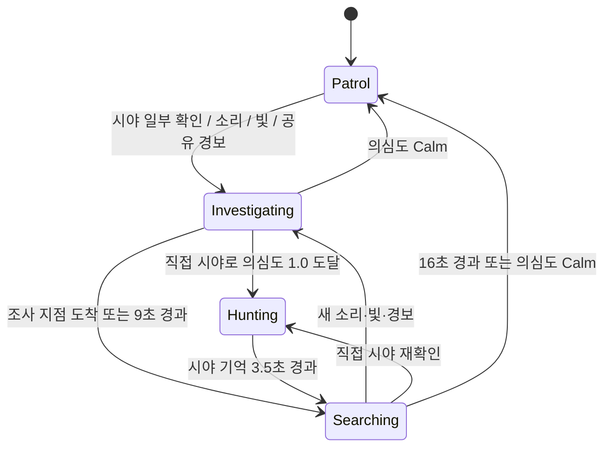

# 몬스터 AI 전체 동작 명세

> 이 문서는 **2026-07-23 현재 코드**를 기준으로 몬스터 AI의 실제 동작을 설명한다.  
> 기획 의도가 아니라 런타임 코드에 연결된 동작을 기준으로 하며, 아직 연결되지 않은 기능은 별도로 표시한다.

## 1. 문서 범위와 코드 위치

| 역할 | 파일 |
|---|---|
| 몬스터 전체 런타임 제어 | `Shooting Horror Game/Assets/Scripts/Monster/Monster_Controller.cs` |
| 시야 판정 | `Shooting Horror Game/Assets/Scripts/Monster/FieldOfView.cs` |
| 체력·사망·총격 반응 | `Shooting Horror Game/Assets/Scripts/Monster/Monster_Health.cs` |
| 의심도·기억·위치 불확실성 | `Shooting Horror Game/Assets/Scripts/MonsterAI/MonsterAwarenessMemory.cs` |
| 감각 증거 데이터 | `Shooting Horror Game/Assets/Scripts/MonsterAI/MonsterStimulus.cs` |
| 전술 선택 모델 | `Shooting Horror Game/Assets/Scripts/MonsterAI/MonsterDecisionModel.cs` |
| 수색 지점 계산 | `Shooting Horror Game/Assets/Scripts/MonsterAI/MonsterSearchPlanner.cs` |
| 의미 기반 소음 이벤트 | `Shooting Horror Game/Assets/Scripts/MonsterAI/MonsterNoiseSystem.cs` |
| 일반 몬스터 간 경보 공유 | `Shooting Horror Game/Assets/Scripts/MonsterAI/MonsterCoordinationHub.cs` |
| 플레이어 이동 소음 | `Shooting Horror Game/Assets/Scripts/Player/PlayerNoiseEmitter.cs` |
| 손전등·Hollow 집광 판정 | `Shooting Horror Game/Assets/Scripts/Player/Flashlight_Controller.cs` |
| 손전등 순수 계산 | `Shooting Horror Game/Assets/Scripts/MonsterAI/FlashlightBeamModel.cs` |
| 난이도별 수치 | `Shooting Horror Game/Assets/Scripts/Manager/GameManager.cs` |

Unity Scene/Prefab에 직렬화된 Inspector 값이 있으면 코드의 필드 초기값보다 Inspector 값이 우선한다.

---

## 2. 몬스터 타입별 요약

`Define.MonsterType`에는 `Normal`, `Hollow`, `Special` 세 타입이 있다.

| 타입 | 현재 실제 동작 |
|---|---|
| `Normal` | 시야·소리·빛·공유 경보를 사용하는 상태 머신, 증거 기억, 전술 추격, 수색, 공격, 총격 경직 |
| `Hollow` | 일반 상태 머신을 우회하고 거리 기반으로 접근한다. 접촉 시 비명·슬로우 후 소멸하며, 총격 또는 집광 손전등으로 제거 가능 |
| `Special` | 전용 구현이 아직 없다. Hollow가 아니므로 Normal 상태 머신 일부를 실행하지만 타입별 체력·난이도 초기화와 의미 기반 소음/공유 경보 수신은 연결되어 있지 않다 |

### 중요한 타입 경계

- `DetectRoutine()`은 **Hollow만 별도 분기**한다.
- Normal과 Special은 일반 감지/상태 머신 경로로 들어간다.
- 하지만 `TypeCheck()`은 Normal과 Hollow만 처리한다.
- `OnNoiseEmitted()`, `OnSharedAlert()`, `OnAlerted()`는 Normal만 허용한다.
- 따라서 Special은 현재 완성된 별도 AI 타입으로 간주하면 안 된다.

---

## 3. 초기화와 실행 주기

## 3.1 `OnEnable()` 초기화

몬스터가 활성화되면 다음을 수행한다.

1. `Player` 태그로 플레이어 검색
2. `NavMeshAgent`, `FieldOfView`, `Rigidbody`, `AudioSource`, `Monster_Health`, `Animator` 캐싱
3. 플레이어의 `Player_Health`, `Player_Controller`, `Rigidbody` 캐싱
4. `NavMeshPath`를 이 시점에 생성
   - MonoBehaviour 필드 초기화 시 생성하지 않으므로 Unity 생성자 오류를 피한다.
5. 공격·스턴·처형·수색·기억·전술 타이머 초기화
6. Normal 상태를 `Patrol`로 초기화
7. 첫 측면 방향을 좌/우 중 무작위 선택
8. 타입과 난이도에 맞는 수치 적용
9. Normal 계열은 소음 및 공유 경보 이벤트 구독
10. `DetectRoutine()` 시작

비활성화되면 이벤트 구독을 해제하고 모든 코루틴을 중단한다.

## 3.2 프레임 `Update()`

매 프레임 수행되는 작업:

- Hollow의 집광 노출이 0.08초 이상 끊겼으면 누적 시간 초기화
- 현재 상태에 따른 이동 속도 갱신
- 실제 `NavMeshAgent.velocity`에 따른 이동 애니메이션 갱신
- Hollow 왜곡 셰이더 갱신
- 수색 중 정지 상태라면 주변을 둘러보도록 회전
- `Listen` 같은 의도적 정지 중이면 증거 위치를 바라봄
- AI Debug 값 갱신

## 3.3 AI 감지 주기

`DetectRoutine()`은 기본 `0.2초` 간격으로 실행된다.

```text
0.2초마다
  ├─ 스턴/처형 중이면 이번 감지 생략
  ├─ Hollow면 HollowBehaviour만 실행하고 종료
  ├─ 기억 노화: 의심도 감소 + 위치 불확실성 증가
  ├─ 시야 확인
  ├─ 조건이 맞으면 소리 확인
  ├─ 조건이 맞으면 빛 확인
  ├─ 현재 Normal 상태 행동 실행
  └─ 공격 가능 여부 확인
```

Hollow의 손전등 노출 누적은 이 0.2초 코루틴이 아니라 손전등 프레임 `Update()`에서 처리한다.

---

## 4. Normal 몬스터 상태 머신

Normal 상태는 네 가지다.



## 4.1 `Patrol`

- `WANDER_RADIUS` 안에서 무작위 NavMesh 지점을 선택한다.
- 완전한 경로가 있는 지점만 이동 대상으로 채택한다.
- 이동을 마치면 `patrolPause + 0~1초` 동안 쉰다.
- 다음 큰 이동 판단은 `WANDER_INTERVAL` 기준이다.
- 기본 코드값:
  - `WANDER_INTERVAL = 5초`
  - `WANDER_RADIUS = 10m`
  - `patrolPause = 2초`
- Scene에 저장된 값은 이 기본값과 다를 수 있다.

## 4.2 `Investigating`

소리, 빛, 불완전한 시야, Hollow 비명, 동료 경보의 추정 위치로 이동한다.

- 의심도가 Calm이면 Patrol 복귀
- `investigationTimeout = 9초`가 지나면 Searching 진입
- 목적지에 도착하거나 경로가 사라지면 Searching 진입
- 전술 판단 주기가 되면 다음 전술을 사용할 수 있다.
  - `Listen`
  - `Hold`
  - `Intercept`
  - `Flank`
- `Listen` 선택 시:
  - 현재 경로를 지움
  - `0.8~1.6초` 정지
  - 증거 위치를 바라봄

## 4.3 `Hunting`

직접 시야로 의심도가 `Alerted`에 도달한 상태다.

- 시야가 유지되면 `UpdateTacticalPursuit()` 실행
- 시야를 놓쳐도 `visualMemoryDuration = 3.5초` 동안 예측 위치를 추적
- 기억 시간이 끝나면 예측 위치를 중심으로 Searching 진입
- 전술 재평가 간격은 `tacticalRepathInterval = 0.55초`
- 전술 경로가 실패하면 예측 직선 추격으로 fallback한다.

## 4.4 `Searching`

마지막 추정 위치 주변을 단계적으로 훑는다.

- 기본 지속 시간: `searchDuration = 16초`
- 기본 반경: `searchRadius = 8m`
- 의심도가 Calm이 되거나 시간이 끝나면 기억을 지우고 Patrol 복귀
- 각 지점 도착 후 `0.65~1.6초` 정지
- 정지 중 현재 방향 기준 `-110°~110°` 범위를 무작위로 바라봄
- 수색 지점은 황금각 `137.507...°`를 사용해 반복을 줄인다.
- 수색 반경은 다음처럼 불확실성에 따라 증가한다.

```text
effectiveSearchRadius
  = searchRadius + min(searchRadius, PositionUncertainty)
```

즉 기본 8m라면 불확실성이 커질 때 최대 약 16m까지 확장될 수 있다.

4개 이상의 수색 단계를 실패하면 `DoubleBack` 또는 `Intercept`가 기존 수색점을 대체할 수 있다.

### 현재 수색 플래너의 실제 연결 상태

`MonsterSearchPlanner`에는 Doorway, Intersection, HidingSpot 등 환경 관심 지점을 점수화하는 API가 존재한다. 그러나 현재 `Monster_Controller`는 `GetFallbackPoint()`만 호출한다. 따라서 **문, 숨을 장소, 교차로를 자동으로 인식해 우선 수색하는 기능은 아직 런타임에 연결되지 않았다.**

---

## 5. 감각 시스템

## 5.1 시야 `FieldOfView`

시야는 별도 `FieldOfView` 컴포넌트가 0.2초마다 판정한다.

판정 순서:

1. `targetMask = Player`로 반경 내 플레이어 Collider 검색
2. 몬스터 전방 기준 시야각 절반 안인지 확인
3. 플레이어가 crouch 상태이고 머리 위에 엄폐물이 있으면 숨은 것으로 처리
4. 몬스터 눈높이에서 플레이어 몸 중심과 머리 지점으로 Raycast
5. 두 지점 중 하나라도 장애물에 막히지 않으면 `playerDetected = true`

눈높이 기본값은 `1.6m`, 앉은 플레이어의 머리 위 엄폐 검사 거리는 `3m`다.

직접 시야가 확보되면:

- 플레이어 현재 위치와 Rigidbody 속도를 기억
- 위치 불확실성을 0으로 초기화
- 공유 정보가 아닌 직접 관측으로 교체
- 의심도를 `visualConfirmationTime` 동안 1.0으로 증가
- `closeRangeInstantDetection = 3m` 안이면 확인 시간을 `0.01초`로 사용
- Alerted에 도달하면 Hunting 진입

## 5.2 의미 기반 소음

`MonsterNoiseSystem`은 AudioSource 볼륨을 추측하는 대신 행동 종류·위치·강도·반경을 이벤트로 전달한다.

현재 정의된 종류:

- `Footstep`
- `Sprint`
- `Crouch`
- `Gunshot`
- `Equipment`
- `Door`
- `Impact`
- `HollowScream`

현재 실제 연결값:

| 행동 | 강도 | 반경 | 발생 간격 |
|---|---:|---:|---:|
| 걷기 | 0.55 | 12m | 0.55초 |
| 달리기 | 1.0 | 22m | 0.34초 |
| 웅크리기 또는 조준 이동 | 0.2 | 5m | 0.8초 |
| 총격 | 1.0 | 40m | 발사 시 |
| 손전등 On/Off | 0.2 | 5m | 조작 시 |
| 문 조작 | 0.65 | 14m | 조작 시 |

몬스터의 의미 기반 소음 해석:

```text
effectiveRange = min(몬스터 청각 범위, 이벤트 반경)
distanceConfidence = 1 - distance / effectiveRange
confidence = loudness × 0.6 + distanceConfidence × 0.4
```

- 벽에 가려지면 `hearingOcclusionMultiplier`를 곱한다. 기본 `0.45`.
- 신뢰도가 0.1 미만이면 무시한다.
- 동시에 여러 이벤트가 오면 현재 대기 중인 것보다 신뢰도가 높은 소음을 우선한다.
- 위치 오차는 `hearingPositionError × (1 - confidence)`이다. 기본 최대 오차는 4m.
- 추정 위치를 NavMesh에 샘플링한 뒤 Investigating으로 이동한다.

## 5.3 기존 AudioSource 청각 fallback

의미 기반 이벤트 외에 기존 AudioSource 감지도 유지된다.

- 플레이어 및 자식의 모든 AudioSource를 캐싱
- 청각 최대 범위 안에서 재생 중인 소리 검사
- `soundDetectionMinRange` 안에서는 볼륨이 0보다 크면 감지
- 그 밖에서는 `detectionMinSound = 0.6` 초과 소리만 대상
- 신뢰도는 볼륨 45%, 거리 55%
- 근거리 신뢰도 최소 0.65
- 벽에 가리면 신뢰도 감소
- 최종 위치에는 신뢰도에 따른 무작위 오차 적용

의미 기반 이벤트가 있으면 대기 큐의 이벤트를 먼저 처리한다.

## 5.4 손전등 빛 감지 — Normal

Normal 몬스터는 켜진 손전등을 다음 두 방식으로 감지한다.

1. 광원 자체가 보이는지
2. 광선이 벽/바닥에 만든 밝은 지점이 보이는지

- 광원 또는 빛 지점이 `lightDetectionRange` 안이어야 한다.
- 장애물 Raycast에 막히면 감지하지 않는다.
- 광원 직접 확인:
  - confidence `0.75`
  - 위치 오차 `0.5m`
  - 광원 근처를 조사
- 빛 지점만 확인:
  - confidence `0.45`
  - 위치 오차 `2m`
  - 벽/바닥의 밝은 지점을 조사
- 빛만 보고 벽 너머 플레이어의 정확한 좌표를 얻지는 않는다.
- 재검사 간격은 `0.8~1.2초`다.

## 5.5 감각 검사 우선순위

- 시야가 있으면 시야를 우선한다.
- Hunting 중 시야를 막 놓친 직후 `visualMemoryDuration` 동안에는 소리·빛보다 기존 시각 기억을 우선한다.
- 시야가 없고 시각 기억 우선 구간도 아니면 소리와 빛을 검사한다.

---

## 6. 인지 기억과 불확실성

`MonsterAwarenessMemory`는 MonoBehaviour가 아닌 순수 상태 모델이다.

저장 정보:

- `Suspicion`: 의심도 0~1
- `TimeSinceVisualContact`: 마지막 직접 시야 이후 시간
- `TimeSinceStimulus`: 마지막 단서 이후 시간
- `LastKnownPosition`: 마지막 추정 위치
- `LastKnownVelocity`: 직접 관측한 플레이어 속도
- `PositionUncertainty`: 위치 오차의 크기
- `LastStimulusConfidence`: 마지막 단서 신뢰도
- `IsSharedMemory`: 동료에게 전달받은 정보인지 여부
- `HasMemory`: 유효한 기억 존재 여부

인지 단계:

| 단계 | 조건 |
|---|---:|
| `Calm` | Suspicion < 0.15 |
| `Suspicious` | Suspicion ≥ 0.15 |
| `Alerted` | Suspicion ≥ 0.999 |

### 직접 시야

- 위치와 속도를 정확하게 기록
- 불확실성 0
- 신뢰도 1
- 공유 기억 해제
- 확인 시간 동안 Suspicion을 1로 이동

### 소리·빛·공유 경보

- 단서만으로 Alerted가 되지 않는다.
- 의심도는 다음 범위로만 상승한다.

```text
max(현재 Suspicion, lerp(0.2, 0.8, confidence))
```

즉 강한 소음도 직접 시야 확인 없이 완전한 추격 권한을 주지 않는다.

### 기억 노화

기본값:

- 감쇠 시작 유예: `3초`
- 의심도 감소: 초당 `0.08`
- 위치 불확실성 증가: 초당 `0.35m`

Suspicion이 0에 도달하면 `Forget()`이 호출되어 기억·속도·불확실성·공유 여부가 초기화된다.

### 위치 예측

```text
예측 위치 = 마지막 위치 + 마지막 속도 × min(시야 상실 시간, predictionLeadTime)
```

`predictionLeadTime` 기본값은 1.25초다.

---

## 7. 감각 증거 `MonsterStimulus`

전술 모델에 전달되는 증거 패킷이다.

| 필드 | 의미 |
|---|---|
| `Type` | None, Visual, Sound, Light, SharedAlert, Environmental |
| `Position` | 추정 위치 |
| `Confidence` | 0~1 신뢰도 |
| `Uncertainty` | 0~1로 정규화한 불확실성 |
| `Timestamp` | 발생 시각 |
| `ObservedVelocity` | 관측 속도 |
| `Shared` | 공유 경보인지 여부 |

전술용 신뢰도:

```text
Reliability = Confidence × (1 - Uncertainty)
```

컨트롤러는 미터 단위 위치 오차를 `searchRadius + hearingPositionError`로 나눠 0~1 범위로 정규화한다.

---

## 8. 전술 의사결정

`MonsterDecisionModel`은 현재 상태 스냅샷으로 가능한 전술의 점수를 계산하고 가장 높은 점수를 선택한다.

입력에는 다음이 포함된다.

- 직접 시야 여부
- 최근 단서 여부: 단서 나이 3초 이하
- 의심도
- 플레이어가 몬스터를 보고 있는지에 대한 근사치
- 플레이어 위치와 속도
- 마지막 위치와 속도
- NavMesh 사용 가능 여부
- 측면·차단·대기 경로 가능 여부
- 수색 4단계 이상 실패 여부

### 플레이어가 몬스터를 인식했는지에 대한 근사

현재는 플레이어 `transform.forward`와 플레이어→몬스터 방향의 내적이 `0.45`보다 큰지로 판단한다.

- 실제 카메라 화면 포함 여부나 벽 가림까지 검사하는 완전한 인식 모델은 아니다.
- 이 값은 주로 `SilentApproach` 선택에 사용된다.

## 8.1 전술별 실제 조건과 효과

| 전술 | 주요 조건 | 실제 효과 | 기본 쿨다운 |
|---|---|---|---:|
| `DirectPursuit` | 직접 시야 + NavMesh 가능 | 플레이어 현재 위치 압박 | 설정값 0.25초* |
| `Listen` | 시야 없음, 2.5초 이내의 최근 단서, Reliability ≤ 0.65 | 0.8~1.6초 정지하고 단서 방향 확인 | 1.5초 |
| `Intercept` | 관측 속도 제곱 크기 ≥ 0.04, 경로 가능 | 이동 방향 앞쪽 `1.6초 × 속도` 지점을 노림 | 4초 |
| `Flank` | 플레이어가 `directPursuitRange`보다 멀고 flank 가능 | 이동 방향 옆 `3.5m` 지점으로 우회 | 5초 |
| `Hold` | 시야 없음, Reliability 또는 Suspicion ≥ 0.45 | 증거 위치에서 몬스터 쪽으로 최대 1.25m 물러난 지점 제어 | 3초 |
| `DoubleBack` | 수색 실패 또는 마지막 단서가 4초 이상 오래됨 | 증거 지점 뒤쪽 2.75m를 다시 확인 | 4.5초 |
| `SilentApproach` | 직접 시야, 플레이어가 몬스터를 안 봄, 거리 > 5m | 목표 뒤쪽 2.5m 지점으로 저속 접근 | 6초 |

### SilentApproach 속도

SilentApproach가 활성화되면 Hunting 속도는 다음 중 작은 값이다.

```text
min(investigationSpeed, chasingSpeed × 0.7)
```

기본값 기준 최대 약 2.2다.

### 측면 방향 변화

- 최초 측면은 좌/우 무작위다.
- Flank를 실행할 때 25% 확률로 다음 측면 방향을 뒤집는다.

### 반복 방지

- 같은 전술은 개별 쿨다운 동안 다시 선택되지 않는다.
- `RepeatWindow = 7초`
- 같은 전술은 이 구간에서 최대 2회 연속 사용 가능
- 세 번째 연속 사용은 차단되어 다른 전술이나 기본 행동을 선택한다.

`Listen`, `Intercept`, `Flank`, `Hold`, `DoubleBack`, `SilentApproach`는 위 제한을 적용한다.  
`DirectPursuit`는 baseline 행동으로 직접 생성되기 때문에 현재 구현에서는 `DirectPursuitCooldown`과 연속 사용 차단을 거치지 않는다. 실제 갱신 빈도는 Controller의 `tacticalRepathInterval`에 의해 제한된다.

### 점수 선택

각 전술은 조건을 만족한 경우 점수를 생성한다. 기본 행동보다 점수가 높을 때만 선택된다. 예를 들어 SilentApproach는 기본 점수가 높지만, 플레이어가 몬스터를 보고 있으면 후보 자체가 생성되지 않는다.

---

## 9. 몬스터 간 제한적 협력

Normal 몬스터가 직접 시야로 처음 Hunting에 진입하면 지역 경보를 방송한다.

송신 기본값:

- 위치: 직접 본 플레이어 위치
- confidence: 1
- uncertainty: 0
- 반경: `coordinationRange = 18m`
- 재송신 쿨다운: `4초`

수신 조건:

- 수신자도 Normal이어야 함
- 자기 자신의 경보는 무시
- 스턴·처형 중이면 무시
- 이미 플레이어를 직접 보고 있으면 무시
- 경보 반경 밖이면 무시

수신 처리:

1. `0.3~1.2초` 전달 지연
2. 거리 비율에 따라 confidence 감소
3. 기본적으로 `coordinationConfidenceLoss = 0.7` 적용
4. 벽에 가리면 추가로 0.75배
5. 최종 confidence < 0.15면 폐기
6. 거리·신뢰도에 따라 위치 오차 추가
7. 오차가 적용된 위치를 NavMesh에 샘플링
8. 공유 기억으로 등록하고 Investigating 진입

공유 경보만으로 Hunting에 바로 진입하지 않는다. 반드시 직접 시야 확인이 필요하다.

현재 협력은 위치 경보 공유까지이며, 수색 구역 분할이나 역할 배정은 구현되어 있지 않다.

---

## 10. NavMesh 이동 안전장치

일반 몬스터의 주요 목적지는 `TrySetDestination()`을 통과한다.

1. Agent가 enabled이며 NavMesh 위인지 확인
2. 후보 위치를 NavMesh에 샘플링
3. `NavMesh.CalculatePath()` 실행
4. `PathComplete`인지 확인
5. 완전한 경로일 때만 `SetDestination()` 호출

이 검사는 `SetDestination()`이 부분 경로도 성공으로 반환할 수 있는 문제를 방지한다. 측면 지점이나 수색점이 다른 NavMesh 섬에 있으면 채택하지 않는다.

Hollow의 단순 접근은 현재 `agent.SetDestination(player.position)`을 직접 호출하며 이 공통 경로 검증을 사용하지 않는다.

---

## 11. 상태별 이동 속도

코드 기본값:

| 상황 | 속도 |
|---|---:|
| Patrol | `normalSpeed = 1.5` |
| Investigating / Searching | `investigationSpeed = 2.2` |
| Hunting, 시야 없음 | `chasingSpeed = 3.5` |
| Hunting, 직접 시야 | `sightChasingSpeed = 4.5` |
| SilentApproach | 최대 약 `2.2` |
| Listen/공격/스턴 | `0` |
| Hollow 접근 | TypeCheck에서 `1.5` |

이동 애니메이션은 목적지 존재 여부가 아니라 실제 Agent 속도가 `0.1` 이상인지로 판단한다.

---

## 12. 공격, 피해, 스턴, 처형

## 12.1 Normal 공격 시작 조건

모두 만족해야 한다.

- 플레이어가 살아 있음
- 공격·스턴·처형 중이 아님
- `FieldOfView.playerDetected == true`
- 수평 거리 ≤ `attackRange = 2m`
- 마지막 공격 후 `attackCooldown = 1.5초` 경과

## 12.2 공격 실행

- Agent 정지
- Attack Bool 활성화
- 애니메이션 속도 `1.25배`
- 실제 Attack 상태 진입을 최대 1초 기다림
- 클립 normalized time `0.54`에서 타격 판정
- 타격 시점에도 거리와 각도를 다시 검사
  - 거리 ≤ `attackHitRange = 2.5m`
  - 전방 총 각도 `attackHitAngle = 100°`
- 클립 종료 후 `attackRecovery = 0.3초`

공격 준비 중에는 플레이어 쪽으로 회전하며, 등 뒤에 있거나 타격 시점에 벗어나면 피해를 주지 않는다.

## 12.3 처형

공격으로 플레이어 체력이 소진되면:

- 몬스터 이동 중지
- 플레이어 입력 잠금
- Execution 파라미터가 있으면 애니메이션 콜백 후 GameOver
- 파라미터가 없으면 즉시 GameOver
- 현재 GameOver는 `Time.timeScale = 0`이며 UI/씬 전환은 TODO다.

## 12.4 Monster 체력과 총격

Normal:

- 체력 500
- `ableToKill = false`
- 총격으로 체력을 깎지 않고 `Stun()` 호출
- 난이도에 따라 6 / 4 / 2.5초 경직

Hollow:

- 체력 1
- `ableToKill = true`
- 총격 데미지로 체력이 0 이하가 되면 비활성화

`Monster_Health.Update()`는 매 프레임 체력이 0 이하이고 `ableToKill`이면 `gameObject.SetActive(false)`를 호출한다.

---

## 13. Hollow AI 전체 동작

Hollow는 Normal의 감각·기억·상태 머신을 사용하지 않는다.

## 13.1 가시성

매 프레임 플레이어와 거리를 확인한다.

- `hollowRange = 10m` 안이면 소재 `_Distortion` 값을 0.05 쪽으로 보간
- 범위 밖이면 0 쪽으로 보간
- 보간 속도는 `Time.deltaTime × 2`

즉 가까워질수록 왜곡 형태로 보이기 시작한다.

## 13.2 이동

0.2초마다:

- 플레이어가 죽었으면 행동하지 않음
- `hollowTouchRange = 1.2m` 안이면 `Scream()`
- 그렇지 않고 난이도별 접근 범위 안이면 플레이어 현재 위치로 이동
- 범위 밖이면 경로 초기화

## 13.3 접촉 비명

Hollow가 플레이어에게 닿으면:

1. 비명 사운드 프리팹 생성
2. 현재 존재하는 다른 몬스터의 `OnAlerted(position)` 호출
3. Normal 몬스터는 해당 위치를 공유 단서로 조사
4. 플레이어에게 난이도별 슬로우 적용
5. Hollow 체력을 0으로 설정
6. 다음 `Monster_Health.Update()`에서 비활성화

슬로우 기본값:

| 난이도 | 이동 배율 | 지속 시간 |
|---|---:|---:|
| Easy | 0.7 | 4초 |
| Normal | 0.5 | 5초 |
| Hard | 0.4 | 6초 |

## 13.4 집광 손전등 소멸

집광 판정은 Hollow가 자신의 중심점을 역산하는 방식이 아니라 **손전등이 빔 중심으로 직접 충돌 검사**하는 방식이다.

조건:

- 손전등이 켜져 있음
- `beamFocus >= hollowFocusThreshold`
- 기본 threshold: `0.8`
- 현재 손전등 조사 거리 안
- 플레이어 자신을 제외한 첫 충돌체가 Hollow의 Collider
- 벽이나 다른 Collider가 먼저 맞으면 차단

손전등은 매 프레임 다음 SphereCast를 수행한다.

- 시작점: 손전등 Light 위치
- 방향: Light의 `transform.forward`
- 반경: `focusedHitRadius = 0.16m`
- 거리: 현재 배터리 상태가 반영된 `Light.range`
- Trigger는 무시
- 플레이어 루트 하위 Collider는 무시

첫 충돌체에서 부모 방향으로 `Monster_Controller`를 찾고 `ReceiveFocusedFlashlight(Time.deltaTime)`을 호출한다.

Hollow 측 처리:

- 매 프레임 노출 시간을 누적
- `hollowFocusedLightExposure = 2초`에 도달하면:
  - NavMesh 경로 초기화
  - 체력 0 설정
  - `CheckHealth()` 즉시 호출
  - GameObject 즉시 비활성화
- 빔 입력이 `0.08초` 이상 끊기면 누적 시간 0으로 초기화

따라서 빛이 잠깐 벗어나거나 벽에 가리면 2초를 처음부터 다시 채워야 한다.

---

## 14. 손전등이 몬스터 AI에 미치는 영향

## 14.1 배터리

- 최대 배터리: 100
- 기본 소모: 초당 1.5
- 켜져 있으면 플레이어 이동 여부와 관계없이 소모
- 집광할수록 소모 배율이 1.0에서 최대 1.2까지 증가
- 0이 되면 자동으로 꺼짐

밝기:

```text
batteryBrightness = lerp(0.05, 1, BatteryRate²)
intensity = 최초 intensity × batteryBrightness × focusBoost
```

- HDR 후처리에서도 감소가 보이도록 제곱 곡선을 사용한다.
- 집광 시 intensity는 최대 1.35배까지 증가한다.

조사 거리:

```text
range = 최초 range × lerp(0.35, 1, BatteryRate)
```

배터리가 줄면 밝기뿐 아니라 실제 AI/Hollow 판정 거리도 줄어든다.

## 14.2 마우스 휠 집광

손전등 장비 중:

- 휠 위: `beamFocus` 증가
- 휠 아래: `beamFocus` 감소
- 입력 장치의 scroll 값이 1 또는 120이어도 한 번당 동일한 단계 사용
- 한 단계: `0.12`
- 넓은 각도: 프리팹 Spot Light의 최초 각도
- 최대 집광 각도: `14°`

## 14.3 흔들기 충전

- 손전등 장비 중 우클릭으로 흔들기 시작
- `0.4초`마다 배터리 4 충전
- 손전등이 켜져 있으면 소모도 동시에 발생하지만 충전량이 더 큼
- 흔들기 AudioSource 볼륨 기본 1.0
- Normal 몬스터의 기존 AudioSource 청각에 감지될 수 있음

---

## 15. 난이도별 수치

| 항목 | Easy | Normal | Hard |
|---|---:|---:|---:|
| 플레이어 최대 체력 | 150 | 100 | 75 |
| Normal 공격 피해 | 25 | 30 | 40 |
| 시야 반경 | 12m | 15m | 20m |
| 시야각 | 100° | 110° | 130° |
| 청각 최대 범위 | 15m | 20m | 30m |
| 무조건 청각 범위 | 4m | 5m | 7m |
| 빛 감지 범위 | 15m | 20m | 30m |
| 총격 경직 | 6초 | 4초 | 2.5초 |
| Hollow 접근 범위 | 8m | 10m | 12m |
| Hollow 슬로우 배율 | 0.7 | 0.5 | 0.4 |
| Hollow 슬로우 시간 | 4초 | 5초 | 6초 |

Normal의 수색 시간, 전술 쿨다운, 추격 속도 등은 현재 난이도별로 분리되지 않고 Controller Inspector 값을 사용한다.

---

## 16. Inspector 주요 기본값

### Normal Intelligence

| 필드 | 기본값 | 의미 |
|---|---:|---|
| `visualConfirmationTime` | 0.65 | 원거리 직접 시야 확정 시간 |
| `closeRangeInstantDetection` | 3 | 즉시 발견 거리 |
| `visualMemoryDuration` | 3.5 | 시야 상실 후 예측 추적 시간 |
| `investigationTimeout` | 9 | 조사 최대 시간 |
| `searchDuration` | 16 | 수색 최대 시간 |
| `searchRadius` | 8 | 기본 수색 반경 |
| `searchPointTolerance` | 1.25 | 지점 도착 판정 거리 |
| `predictionLeadTime` | 1.25 | 예측 최대 시간 |
| `directPursuitRange` | 6 | 이 거리 안에서는 측면 경로 조건 해제 |
| `flankDistance` | 4 | Controller 측 flank 활성 조건/설정 |
| `tacticalRepathInterval` | 0.55 | 전술 재판단 간격 |
| `hearingPositionError` | 4 | 최대 소리 위치 오차 |
| `hearingOcclusionMultiplier` | 0.45 | 벽 너머 소리 신뢰도 배율 |
| `suspicionDecayDelay` | 3 | 기억 감쇠 유예 |
| `suspicionDecayPerSecond` | 0.08 | 초당 의심도 감소 |
| `uncertaintyGrowthPerSecond` | 0.35 | 초당 위치 오차 증가 |
| `coordinationRange` | 18 | 동료 경보 반경 |
| `coordinationConfidenceLoss` | 0.7 | 공유 신뢰도 배율 |
| `coordinationDelayRange` | 0.3~1.2 | 공유 경보 반응 지연 |
| `coordinationSpread` | 3 | 거리 기반 공유 위치 오차 |
| `coordinationBroadcastCooldown` | 4 | 재방송 제한 |

### Hollow

| 필드 | 기본값 | 의미 |
|---|---:|---|
| `hollowRange` | 10 | 왜곡 가시 범위 |
| `hollowApproachRange` | 10 | 코드 기본 접근 범위, 난이도로 덮어씀 |
| `hollowTouchRange` | 1.2 | 접촉 비명 거리 |
| `hollowFocusedLightExposure` | 2 | 집광 소멸 필요 시간 |

### 손전등 집광

| 필드 | 기본값 |
|---|---:|
| `focusedSpotAngle` | 14° |
| `focusStepPerScroll` | 0.12 |
| `focusedIntensityBoost` | 1.35 |
| `focusedDrainMultiplier` | 1.2 |
| `hollowFocusThreshold` | 0.8 |
| `focusedHitRadius` | 0.16m |

---

## 17. 디버그 값

## 17.1 Normal `Monster_Controller > AI Debug`

| 값 | 의미 |
|---|---|
| `currentIntent` | 상태 전환 직후에는 Patrol / Investigating / Hunting / Searching, 전술 평가 후에는 Patrol / Investigate / Search / Hunt / Ambush |
| `currentTactic` | 현재 선택된 전술 |
| `currentDecisionReason` | 전술 선택 이유 |
| `currentSuspicion` | 현재 의심도 |
| `currentPositionUncertainty` | 추정 위치 오차 |

전술 이유 종류:

- `AmbiguousStimulus`: 불확실한 단서
- `FreshEscapeVector`: 신뢰 가능한 도주 방향
- `ExposedApproach`: 직선 접근이 노출됨
- `ChokePointControl`: 예상 지점 제어
- `BrokenSearchLoop`: 반복 수색 실패
- `UnawareTarget`: 플레이어가 몬스터를 보지 않음
- `DirectVisualPressure`: 직접 시야 압박

## 17.2 Hollow

| 값 | 의미 |
|---|---|
| `hollowLightExposureProgress` | 현재 연속 집광 노출 시간 |
| `hollowLightExposureState` | `None`, `Direct focused beam`, `Beam lost`, `Dispelled` |

## 17.3 손전등

| 값 | 의미 |
|---|---|
| `battery` | 현재 배터리 |
| `beamFocus` | 현재 집광도 0~1 |
| `focusedBeamHit` | 집광 중심 SphereCast가 처음 맞힌 오브젝트 이름 |

Hollow가 제거되지 않을 때 확인 순서:

1. `beamFocus >= 0.8`인지
2. `focusedBeamHit`이 벽이 아니라 Hollow인지
3. Hollow 상태가 `Direct focused beam`인지
4. `hollowLightExposureProgress`가 증가하는지
5. 빔이 벗어나 `Beam lost`로 초기화되는지

---

## 18. 현재 구현상의 한계

아래는 코드에 존재하지 않거나 아직 런타임에 완전히 연결되지 않은 기능이다.

1. **환경 의미 수색 미연결**
   - `MonsterSearchPlanner`는 문·교차로·숨는 곳 점수화를 지원하지만 Controller는 황금각 fallback만 사용한다.
2. **Special 전용 AI 미완성**
   - 별도 초기화, 의미 소음, 공유 경보 정책이 없다.
3. **플레이어 인식 추정이 단순함**
   - SilentApproach용 인식 여부는 플레이어 transform 방향 내적만 사용한다.
4. **협력은 위치 방송만 지원**
   - 포위 역할, 수색 구역 분할, 문 차단은 없다.
5. **공격은 직접 시야 필수**
   - 예상 위치로 선제 공격하거나 숨는 곳을 공격하지 않는다.
6. **Hollow 이동 경로 검증이 단순함**
   - Normal의 `TrySetDestination()` 완전 경로 검사를 사용하지 않는다.
7. **손전등 SphereCast는 첫 충돌체 기준**
   - 작은 소품 Collider도 Hollow보다 먼저 맞으면 빛을 차단한다.
8. **Scene 체감 튜닝 필요**
   - NavMesh 폭, 장애물 LayerMask, 몬스터 Collider, 애니메이션 전이에 따라 실제 체감이 달라진다.

---

## 19. 테스트와 검증 범위

EditMode 순수 모델 테스트는 다음을 다룬다.

- 시야 확인 누적과 Alerted 전이
- 소리/빛 단서가 즉시 Alerted를 만들지 않는지
- 기억 감쇠와 불확실성 증가
- 공유 단서를 직접 관측이 교체하는지
- Stimulus 신뢰도와 예측
- Listen / SilentApproach / Intercept / 반복 제한
- 수색 후보 점수와 황금각 fallback
- 의미 기반 소음·공유 경보 값 보정
- 손전등 배터리 밝기 곡선
- 집광 각도와 휠 단계
- 집광 빔 순수 원뿔 판정

최근 자동 회귀 테스트 기준 23개가 통과했다. 다만 NavMesh 실제 이동, Animator 전이, Physics SphereCast, Hollow 소멸 체감은 PlayMode/실제 Scene 검증 대상이다.

---

## 20. 전체 동작 예시

### 예시 A: 플레이어가 멀리서 달림

1. Sprint 이벤트 발생: 강도 1, 반경 22m
2. 범위 안 Normal이 거리·벽을 반영해 confidence 계산
3. 정확하지 않은 예상 위치 생성
4. Suspicious 상태로 Investigating 진입
5. 단서가 불확실하면 잠시 Listen
6. 현장 도착 후 황금각 수색
7. 직접 시야를 확보해야 Hunting 전환

### 예시 B: 플레이어가 손전등으로 벽만 비춤

1. 몬스터가 광원 자체는 못 보고 벽의 빛 자국만 봄
2. confidence 0.45, 위치 오차 2m 단서 생성
3. 플레이어 실제 좌표가 아닌 벽 지점을 조사
4. 플레이어가 조용히 이동하면 몬스터는 잘못된 위치를 수색할 수 있음

### 예시 C: Normal 한 마리가 플레이어 발견

1. 시야 확인 누적으로 Suspicion 1
2. Hunting 진입
3. 18m 안 동료에게 경보 방송
4. 동료는 0.3~1.2초 뒤 부정확한 위치 수신
5. 동료는 즉시 Hunting하지 않고 Investigating
6. 직접 시야를 얻은 몬스터만 전력 추격

### 예시 D: 플레이어가 몬스터를 보지 않음

1. 몬스터가 플레이어를 직접 봄
2. 플레이어 forward가 몬스터 방향이 아니며 거리 > 5m
3. SilentApproach 후보 생성
4. 다른 전술보다 점수가 높으면 속도를 줄이고 뒤쪽 예상 지점으로 접근
5. 플레이어가 돌아보거나 조건이 달라지면 다음 전술 주기에 재평가

### 예시 E: 집광 손전등으로 Hollow 제거

1. 손전등 장착 및 켜기
2. 휠 위로 집광도를 0.8 이상 올림
3. 빔 중심 SphereCast가 Hollow Collider를 첫 번째로 맞힘
4. 매 프레임 노출 누적
5. 2초 동안 빔을 유지하면 Hollow 즉시 비활성화
6. 중간에 벽이나 다른 물체가 가리면 누적 초기화
